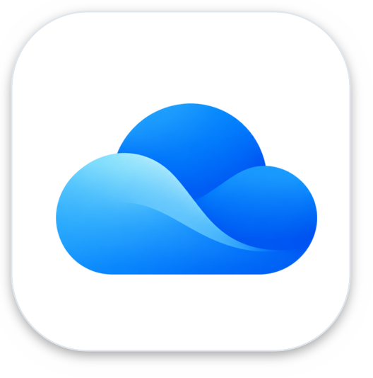

<div align="center">



# TeleNest

**A Native, Privacy-First Unlimited Cloud Drive for Android Powered by Telegram MTProto & TDLib**

[](https://github.com/hasibullakhan/TeleNest/releases/latest)
[](https://github.com/hasibullakhan/TeleNest/releases/latest/download/TeleNest-v3.1.0.apk)
[-3DDC84?style=for-the-badge&logo=android&logoColor=white)](https://developer.android.com)
[](https://kotlinlang.org)
[](https://developer.android.com/jetpack/compose)
[](https://github.com/hasibullakhan/TeleNest)
[](LICENSE)

[**Download Latest APK (v3.1.0)**](https://github.com/hasibullakhan/TeleNest/releases/latest) • [**Full Feature Guide**](#-detailed-features--capabilities) • [**Report a Bug**](https://github.com/hasibullakhan/TeleNest/issues) • [**Request a Feature**](https://github.com/hasibullakhan/TeleNest/issues) • [**Author Profile**](https://www.facebook.com/HasibullaKhanHK)

</div>

---

## 📖 Overview

**TeleNest** is an open-source, modern Android cloud drive application that turns your Telegram account into an organized, high-speed, and truly unlimited personal cloud workspace. It merges the familiar interface and file organization of **Google Drive** and **MEGA** with the speed, stability, and zero-cost cloud infrastructure of Telegram.

Unlike third-party bots, web wrappers, or cloud middleman services that risk your privacy, TeleNest is a **100% native Android client**. It embeds the official **TDLib (Telegram Database Library)** native engine (`libtdjni.so`), establishing direct, encrypted **MTProto 2.0** connections from your device straight to Telegram's cloud servers. Your phone number, two-factor authentication credentials, encryption keys, and files **never** pass through any third-party intermediary server.

---

## ✨ Feature Highlights at a Glance

| Feature Category | Highlights |
| :--- | :--- |
| ☁️ **Cloud Storage** | 100% Free, Unlimited Storage, No Subscription, Original File Quality, Auto-Split for >2GB Files |
| 📁 **Drive Experience** | Unlimited Nested Folders, 24 Custom Colors, Grid & List Layouts, Scroll State Memory, Home Screen Pinning |
| 🔒 **Privacy & Vault** | Client-Side E2EE (AES-256-GCM / Argon2), SQLCipher Encrypted Database, Biometric & PIN Lock |
| ⚡ **Transfer Engine** | Native Foreground Service, Pause/Resume/Cancel, Byte-accurate Progress Gauges |
| 🔄 **AutoSync & Folder Pairs** | Full AutoSync Engine (Two-way, Upload only, Upload & delete, Mirror, Download), Instant Upload, File Filters |
| 🎬 **Built-in Media** | Media3 (ExoPlayer) Video Streaming with Gestures, Background Audio Player, PDF Reader, Code Editor, APK Installer |
| 🔍 **Search & Sorting** | Real-time Search, Smart Filter Chips (Photos, Videos, Audio, Docs, APKs), Multi-attribute Sorting |
| 🗑️ **Recycle Bin** | 30-Day Trash Grace Period, One-Tap Exact Path Restoration, Permanent Deletion |
| 💾 **Offline Vault** | Permanent Cache-Immune Offline Storage, Granular Cache Cleaner & Storage Analyzer |
| 🎨 **Design & Themes** | Material Design 3, Pure Black AMOLED (#000000), 14+ Accent Color Palettes, Adaptive Sizing |
| 👥 **Multi-Account** | Google Drive-Style Multi-Account Login, 1-Tap Instant Account Switching, 100% Isolated Databases & Sessions |
| 🔄 **In-App Updater** | Direct GitHub Releases Integration, In-App Progress Bar & One-Tap APK Installation |
| 🌐 **Localization** | 11 Fully Supported Languages with Dynamic In-App Language Switching |

---

## 🚀 Detailed Features & Capabilities

### 📁 1. Google Drive-Inspired File & Folder Hierarchy
- **Unlimited Nested Subdirectories:** Create nested folders inside folders to any depth. Supports both **Virtual Folders** (tracked through a synchronized cloud manifest JSON in your Telegram Saved Messages) and **Channel Folders** (dedicated private Telegram channels per root workspace).
- **24-Color Custom Folder Palette:** Color-code any directory with 24 Google Drive-inspired colors (Sapphire, Emerald, Crimson, Amber, Amethyst, etc.) for instant visual navigation. Folder colors are synchronized with the cloud manifest.
- **Dual Responsive Layout Modes:**
  - **Grid View:** Adaptive Material 3 cards showcasing folder accent colors, live recursive metrics (`X files • Y MB`), and high-resolution thumbnail previews for images and videos.
  - **List View:** High-density, space-efficient rows displaying file format badges, exact byte sizes, upload timestamps, and quick action menus.
- **Folder Navigation State & Scroll Memory:** Preserves the exact scroll position when opening any folder and navigating back. No erratic auto-scrolling or lost list states.
- **Pin Folders to Android Home Screen:** Uses Android `ShortcutManager` to create direct launcher shortcuts for frequently accessed folders. Tapping a pinned shortcut launches TeleNest directly inside that directory.
- **Interactive Move & Copy Engine:** A bottom sheet browser lets you navigate up and down your full folder tree, create new destination subdirectories on the fly, and recursively relocate files and folders across virtual and channel workspaces.
- **Accurate Filename & Extension Preservation:** Leverages Android SAF and MediaStore resolution to ensure original file names, special characters, and extensions are preserved during uploads.

---

### ☁️ 2. Unlimited Telegram Cloud Infrastructure
- **Truly Unlimited & Free Cloud Storage:** Store terabytes of photos, documents, videos, backups, and archives using Telegram's enterprise-grade MTProto server network without recurring fees.
- **Zero Compression / Original Quality:** Every file is transmitted as a raw binary document (`TdApi.InputMessageDocument`), preserving 100% lossless fidelity, EXIF metadata, RAW photo details, and uncompressed 4K bitrates.
- **Large File Splitting & Seamless Merging (>2GB):** Automatically splits files larger than Telegram's per-message upload cap (2 GB for standard accounts, 4 GB for Telegram Premium) into numbered binary parts with verification checksums, reassembling them into the exact original file upon download.
- **Direct MTProto 2.0 Client:** Zero proxy servers, zero third-party bots. All network packets travel directly between your phone and Telegram's official data centers via native C++ TDLib bindings.

---

### 🔒 3. Zero-Knowledge Client-Side Encryption & Secure Vault
- **Military-Grade E2EE Encryption:** Sensitive files uploaded to your **Secure Vault** are encrypted on your device using **Libsodium (`lazysodium-android`)** with **AES-256-GCM** and **XChaCha20-Poly1305**. Keys are derived using memory-hard **Argon2id** password hashing. Telegram servers store only encrypted blobs and cannot read your contents.
- **SQLCipher Encrypted Local Database:** All cached directory indexes, thumbnails metadata, and user preferences are secured in a local Room database protected by **256-bit AES SQLCipher** encryption.
- **Biometric & Master PIN Protection:** Lock the entire application or restrict access to the Secure Vault using your device's fingerprint scanner, facial recognition (`AndroidX BiometricPrompt`), or a custom master PIN code.
- **Auto-Lock Timeout:** Configurable inactivity timer automatically locks the vault when you switch apps or lock your phone.
- **Anti-Screenshot & Capture Guard:** Optional flag (`FLAG_SECURE`) to prevent unauthorized screenshots or screen recordings inside secure vaults.

---

### ⚡ 4. Transfer Engine & Background Auto-Backup
- **Foreground Transfer Service:** Heavy multi-file uploads and downloads run reliably through an Android Foreground Service equipped with persistent status bar notifications, live transfer speed gauges, and byte-level progress bars.
- **Pause, Resume & Cancel Controls:** Pause any active transfer, resume interrupted downloads without losing progress, or cancel individual transfers.
- **Dedicated Transfer Center:** Centralized screen inside the navigation drawer showing **Active**, **Completed**, and **Failed** transfers, complete with retry actions and clear options.
- **Cloud Metadata Backup & History:** Automatically mirrors your virtual folder trees, starred lists, and color manifests to the cloud, allowing one-tap restoration on new devices.

---

### 🔄 5. Advanced AutoSync & Folder Pairs Engine
TeleNest features a full-fledged folder synchronization engine inspired by AutoSync, allowing you to pair any local phone directory (or entire internal storage) with any Telegram cloud folder:
- **5 Versatile Sync Methods:**
  - 🔄 **Two-way sync:** Keeps device and cloud folders in sync. New/updated files transfer both ways, deletions propagate seamlessly.
  - ⬆️ **Upload only:** Uploads new/modified local files to the cloud. Deletions on device are preserved in cloud.
  - 📦 **Upload then delete:** Uploads new files and safely deletes local copies to free up internal phone storage.
  - 🪞 **Mirror:** Cloud is an exact mirror of local folder. Any files removed locally are removed from cloud.
  - ⬇️ **Download:** Downloads new cloud files to local device.
- **Instant Upload & Real-time File Observers:** Detects new photos, recordings, or downloads immediately upon saving and syncs without delay.
- **Granular Filter & Safety Controls:**
  - Exclude hidden files & folders (`.nomedia`, dotfiles).
  - Exclude subfolders or auto-sync all subdirectories recursively.
  - Delete empty subfolders automatically after synchronization.
  - Filter by file name or extension (e.g. `*.jpg`, `*.pdf`, `*.mp4`).
- **Flexible Network & Power Conditions:** Configurable sync triggers for **Wi-Fi only**, **Charging only**, battery level constraints, and custom sync intervals (from 5 minutes to daily).

---

### 🎬 6. Built-in Media Players & Document Viewers
- **ExoPlayer Video Streaming (AndroidX Media3):** Stream high-definition videos directly from Telegram's cloud without waiting for full downloads. Includes touch gestures (swipe for brightness and volume, double-tap to seek), Picture-in-Picture (PiP) support, playback speed controls (0.25x – 2.0x), and aspect ratio toggles.
- **Integrated Background Audio Player:** Plays music and audio tracks with background playback, lock screen media controls, playlist queues, and audio scrubbers.
- **Pinch-to-Zoom Image Gallery:** High-performance photo viewer powered by **Coil** with multi-touch zoom, pan gestures, EXIF metadata inspection (camera model, aperture, ISO, timestamp), and instant sharing.
- **Native PDF Document Viewer:** Smooth multi-page PDF rendering directly inside the app with page thumbnails and pinch-to-zoom.
- **Code & Text File Viewer:** Syntax-highlighted viewer for code, logs, Markdown, JSON, and text files.
- **APK Package Inspector & Direct Installer:** Inspects Android Application Packages (package name, version code, app icon, target SDK) and allows direct, safe installation.

---

### 🔍 6. Smart Search, Categorization & Filtering
- **Real-Time Instant Search:** Rapidly search through thousands of cloud files and directories by keyword, filename, or extension with instant UI updates.
- **Category Filter Chips:** Instant one-tap filtering in any folder or global media tab:
  - 🖼️ **Photos:** JPEG, PNG, WEBP, GIF, RAW, SVG
  - 🎥 **Videos:** MP4, MKV, AVI, MOV, WEBM
  - 🎵 **Audio:** MP3, FLAC, WAV, AAC, OGG, M4A
  - 📄 **Documents:** PDF, DOCX, XLSX, PPTX, TXT, EPUB
  - 📦 **APKs:** Android Application Packages
- **Dual Directional & Attribute Sorting:**
  - Sort by **Name** (A–Z / Z–A)
  - Sort by **Date Modified** (Newest / Oldest)
  - Sort by **File Size** (Largest / Smallest)
  - Tactile, elevated sort direction and menu buttons for swift switching.
- **Dedicated Media Tab & Starred Workspace:**
  - **Media Tab:** Aggregates all cloud photos and videos into an infinite chronological gallery.
  - **Starred Tab:** Quick access to bookmarked critical files and folders across all workspaces.

---

### 🗑️ 7. 30-Day Recycle Bin (Trash & Restore Engine)
- **Soft-Delete Safety Net:** Accidental file or folder deletions are moved to the Trash rather than permanently purged.
- **30-Day Grace Period:** Items remain in the Recycle Bin for 30 days with live countdown days indicators before automated permanent deletion.
- **One-Tap Exact Restoration:** Restores any file or nested folder tree back to its original parent channel or virtual folder path.
- **Permanent Destruction:** Permanently delete specific sensitive files or empty the entire trash bin with a single tap.

---

### 💾 8. Available Offline & Cache Management
- **Permanent Offline Vault:** Mark important files as **Available Offline**. These files are saved to protected internal app storage (`filesDir/offline_files`) and are completely immune to cache clearing or network outages.
- **Granular Storage Analyzer:** Visual pie charts and breakdown meters showing **Cloud Usage** vs. **Local Device Usage**.
- **Custom Cache Policies:** Set maximum cache size thresholds (e.g., 500 MB, 2 GB, 10 GB, Unlimited) and automatically prune cached files older than 7, 30, or 90 days.

---

### 🎨 9. Material Design 3 & Pure Black AMOLED Theme
- **Google Material Design 3 (M3):** Follows modern M3 design standards with dynamic tonal elevation, fluid animations, and responsive components.
- **Pure Black AMOLED Mode (`#000000`):** Features true black backgrounds optimized for OLED/AMOLED screens, delivering maximum contrast and significant battery savings.
- **14+ Material 3 Accent Themes:** Choose from an extensive palette of primary theme colors (Ocean Blue, Teal, Emerald Green, Indigo, Amber, Sunset Orange, Ruby Red, etc.).
- **3-Way Theme Mode:** Seamlessly toggle between **Light**, **Dark**, and **Use System Default**.
- **Dynamic Adaptive Layouts:** Optimized for compact phones, large screens, foldables, and tablets.

---

### 🔄 10. Direct In-App Auto-Updater
- **GitHub Releases Integration:** Built-in repository update engine that queries the GitHub Releases API (`api.github.com/repos/hasibullakhan/TeleNest/releases/latest`).
- **One-Tap Update Flow:** Displays changelog notes, version numbers, and file sizes directly in-app.
- **Native Package Installer:** Downloads the release APK into secure cache and invokes Android's `PackageInstaller` for a frictionless update experience without requiring manual browser downloads.

---

### 🌐 11. Multi-Language Internationalization (11 Languages)
TeleNest is localized into 11 languages, switchable on-the-fly without restarting:
1. 🇺🇸 **English** (`en`)
2. 🇧🇩 **বাংলা — Bengali** (`bn`)
3. 🇮🇳 **हिन्दी — Hindi** (`hi`)
4. 🇪🇸 **Español — Spanish** (`es`)
5. 🇫🇷 **Français — French** (`fr`)
6. 🇸🇦 **العربية — Arabic** (`ar`)
7. 🇧🇷 **Português — Portuguese** (`pt`)
8. 🇷🇺 **Русский — Russian** (`ru`)
9. 🇵🇰 **اردو — Urdu** (`ur`)
10. 🇩🇪 **Deutsch — German** (`de`)
11. 🇨🇳 **中文 — Chinese** (`zh`)

---

### 👥 12. Google Drive-Style Multi-Account & Instant Account Switcher
- **Log In to Multiple Telegram Accounts:** Sign in to 2, 3, 5, or more Telegram accounts simultaneously without ever logging out of your primary account.
- **1-Tap Instant Account Switching:** Switch between your saved Telegram accounts directly from the **Profile Screen** (`Telegram Accounts` switcher card) with a single tap, just like switching Gmail accounts in Google Drive.
- **100% Per-Account Data & Session Isolation:**
  - **Dedicated TDLib Session Slots:** Each account runs in its own isolated native TDLib directory (`tdlib` vs `tdlib_slot_<id>`).
  - **Per-Account Encrypted Room Databases:** Managed dynamically by `AccountDatabaseManager` (`teledrive.db` vs `teledrive_slot_<id>.db`) using reactive `flatMapLatest` Flow switching so files, folders, thumbnails, starred items, and trash never mix across accounts.
  - **Scoped Cloud Manifests:** Virtual folders, folder colors, and cloud manifests are strictly isolated per account slot.
- **Seamless Account Management:** Pre-fills your saved Telegram API ID & API Hash when adding a new account, includes a `"Back to Previous Account"` option during login, and automatically switches to the next active account if you log out of the current one.

---

## 🏗️ Technical Architecture & Under the Hood

TeleNest follows Google's recommended **Clean Architecture** and **Modern Android Architecture (MVI / MVVM)** patterns:

```text
┌────────────────────────────────────────────────────────────────────────┐
│                        Jetpack Compose UI Layer                        │
│   Material 3 • Adaptive Screens • Navigation • StateFlow ViewModels    │
└───────────────────────────────────┬────────────────────────────────────┘
                                    │
┌───────────────────────────────────▼────────────────────────────────────┐
│                       Domain & Use Cases Layer                         │
│   DriveRepository • AuthRepository • TransferManager • CryptoManager   │
└─────────┬─────────────────────────┬──────────────────────────┬─────────┘
          │                         │                          │
┌─────────▼──────────┐   ┌──────────▼──────────┐   ┌───────────▼─────────┐
│    TDLib Native    │   │  Encrypted Storage  │   │  Background Engine  │
│   libtdjni (C++)   │   │  Room + SQLCipher   │   │   TransferService   │
│   MTProto 2.0 RPC  │   │ Lazysodium + Argon2 │   │ WorkManager Backup  │
└─────────┬──────────┘   └─────────────────────┘   └─────────────────────┘
          │
┌─────────▼──────────────────────────────────────────────────────────────┐
│                    Telegram Cloud (MTProto Servers)                    │
│      Saved Messages • Private Cloud Channels • JSON Manifest Sync      │
└────────────────────────────────────────────────────────────────────────┘
```

### Key Libraries & Tech Stack

| Technology | Purpose |
| :--- | :--- |
| **Kotlin 2.0** | Core programming language with Coroutines and Flow |
| **Jetpack Compose (M3)** | Declarative UI framework with Material You dynamic color system |
| **TDLib (Telegram Database Library)** | Native C++ library for direct MTProto 2.0 communication |
| **Room + SQLCipher** | 256-bit AES encrypted SQLite database for offline caching and metadata |
| **Libsodium (`lazysodium-android`)** | Zero-knowledge client-side encryption (AES-256-GCM / XChaCha20-Poly1305) |
| **Argon2** | Memory-hard key derivation for master passwords |
| **AndroidX Media3 (ExoPlayer)** | Video streaming and background audio playback engine |
| **Coil** | Asynchronous image loading, thumbnail caching, and SVG rendering |
| **AndroidX WorkManager** | Periodic background media and camera backup |
| **Dagger Hilt** | Dependency injection framework |
| **Kotlinx Serialization** | High-performance JSON serialization for cloud manifests |

---

## 📊 Comparison: TeleNest vs. Alternatives

| Feature | TeleNest | Google Drive | Telegram Saved Messages | Web-Based Telegram Bots |
| :--- | :---: | :---: | :---: | :---: |
| **Storage Cap** | **Unlimited** | 15 GB Free | Unlimited | Account Bound |
| **Subscription Cost** | **100% Free** | Monthly Fee | Free | Often Paid / Ad-Supported |
| **Folder Hierarchy** | **Full Nested Folders** | Full Nested Folders | Flat Chat Stream | Limited / Flat |
| **Client-Side E2EE** | **Yes (Argon2 + AES)** | No (Google has keys) | No | Rarely |
| **Direct MTProto Connection** | **Yes (Direct to Telegram)** | N/A | Yes | **No (Relies on 3rd-party servers)** |
| **Color Coding** | **24 Folder Colors** | Yes | No | No |
| **Recycle Bin (Trash)** | **Yes (30-day restore)** | Yes | No (Instant delete) | No |
| **Integrated Video/Audio Player** | **Yes (Media3 ExoPlayer)** | Basic | Basic | Web Player |
| **Offline Vault** | **Yes (Cache-Immune)** | Yes | Cache Only | No |

---

## 🛠️ Building & Compiling from Source

### Prerequisites
- **Android Studio** Ladybug (2024.2.1) or newer
- **JDK 17** or **JDK 21**
- **Android SDK** API 36 (`compileSdk = 36`, `minSdk = 24`)
- **Git** with LFS support

### Step-by-Step Instructions

1. **Clone the Repository:**
   ```bash
   git clone https://github.com/hasibullakhan/TeleNest.git
   cd TeleNest
   ```

2. **Configure Telegram API Credentials:**
   - Visit [my.telegram.org](https://my.telegram.org) and log in with your phone number.
   - Navigate to **API development tools** and create an application to obtain your `api_id` and `api_hash`.
   - Add your credentials in `app/build.gradle.kts` or inject them through environment variables / secrets configuration.

3. **Build the Debug APK:**
   ```bash
   ./gradlew assembleDebug
   ```
   The compiled APK will be generated at `app/build/outputs/apk/debug/app-debug.apk`.

4. **Install onto Device via ADB:**
   ```bash
   adb install -r app/build/outputs/apk/debug/app-debug.apk
   ```

---

## 🔐 Security & Privacy Policy

- **No Intermediate Servers:** TeleNest does not host or operate any middleman server. Communication takes place strictly between your device and Telegram's official servers.
- **No Analytics & No Tracking:** Zero analytics SDKs, zero advertising frameworks, and zero tracking pixels.
- **Open Source Auditability:** All source code is publicly accessible in this repository for community review and verification.

---

## 👤 Author & Maintainer

**Hasibulla Khan**
- 🌐 **Facebook:** [facebook.com/HasibullaKhanHK](https://www.facebook.com/HasibullaKhanHK)
- 🐙 **GitHub:** [@hasibullakhan](https://github.com/hasibullakhan)
- 📧 **Contact:** `hasibullakhanhk@gmail.com`

---

## 📄 License

This project is open-source software licensed under the **[MIT License](LICENSE)**.  
Copyright © 2026 **Hasibulla Khan**. All rights reserved.
