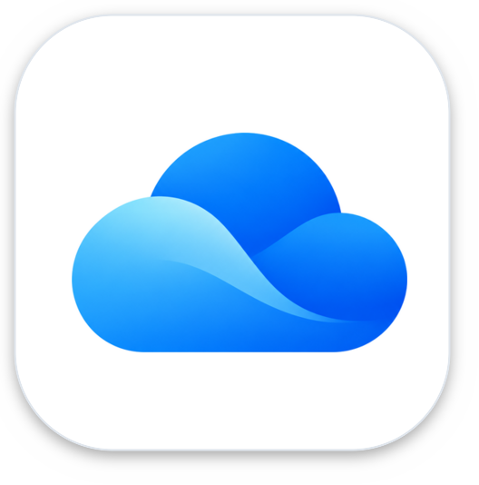

<div align="center">



# TeleNest

**A Native, Privacy-First Unlimited Cloud Drive for Android Powered by Telegram MTProto & TDLib**

[](https://github.com/hasibullakhan/TeleNest/releases/latest)
[](https://github.com/hasibullakhan/TeleNest/releases/latest)
[-3DDC84?style=for-the-badge&logo=android&logoColor=white)](https://developer.android.com)
[](https://kotlinlang.org)
[](https://developer.android.com/jetpack/compose)
[](https://github.com/hasibullakhan/TeleNest)
[](LICENSE)

[**Download Latest APK**](https://github.com/hasibullakhan/TeleNest/releases/latest) • [**Full Feature Guide**](#-detailed-features--capabilities) • [**Report a Bug**](https://github.com/hasibullakhan/TeleNest/issues) • [**Request a Feature**](https://github.com/hasibullakhan/TeleNest/issues) • [**Author Profile**](https://www.facebook.com/HasibullaKhanHK)

</div>

---

## 📖 Overview

**TeleNest** is an open-source, modern Android cloud drive application that turns your Telegram account into an organized, high-speed, and truly unlimited personal cloud workspace. It merges the familiar interface and file organization of **Google Drive** and **MEGA** with the speed, stability, and zero-cost cloud infrastructure of Telegram.

Unlike third-party bots, web wrappers, or cloud middleman services that risk your privacy, TeleNest is a **100% native Android client**. It embeds the official **TDLib (Telegram Database Library)** native engine (`libtdjni.so`), establishing direct, encrypted **MTProto 2.0** connections from your device straight to Telegram's cloud servers. Your phone number, two-factor authentication credentials, encryption keys, and files **never** pass through any third-party intermediary server.

---

## What's new in TeleNest Flow (v3.5.0)

- Refreshed light and dark themes, a cleaner drive header, and a Transfers screen with separate Uploads and Downloads views.
- File preparation and batch submission run off the Android UI thread. Preparation shows progress, reports unreadable files, and can be cancelled.
- Vault exports verify decryption before replacing the destination. Biometric lockout opens the password prompt.

## ✨ Feature Highlights at a Glance

| Feature Category | Highlights |
| :--- | :--- |
| ☁️ **Cloud Storage** | 100% Free, Unlimited Storage, No Subscription, Original File Quality, Auto-Split for >2GB Files |
| 📁 **Drive Experience** | Unlimited Nested Folders, 24 Custom Colors, Grid & List Layouts, Scroll State Memory, Home Screen Pinning |
| 🔒 **Privacy & Vault** | Client-Side Vault Encryption (AES-256-GCM + PBKDF2), Android Keystore-bound Biometric Unlock, Argon2id Master Password, Encrypted Settings |
| ⚡ **Transfer Engine** | Native Foreground Service, Pause/Resume/Cancel, Byte-accurate Progress Gauges |
| 🔄 **AutoSync & Folder Pairs** | Full AutoSync Engine (Two-way, Upload only, Upload & delete, Mirror, Download), Instant Upload, File Filters |
| 🎬 **Built-in Media** | Media3 (ExoPlayer) Video & Audio Playback, Photo Viewer with Pinch-to-Zoom, PDF Reader, Text Viewer, APK Installer |
| 🔍 **Search & Sorting** | Real-time Search, Smart Filter Chips (Photos, Videos, Audio, Docs, APKs), Multi-attribute Sorting |
| 🗑️ **Recycle Bin** | 30-Day Trash Grace Period, One-Tap Exact Path Restoration, Permanent Deletion |
| 💾 **Offline Vault** | Permanent Cache-Immune Offline Storage, Granular Cache Cleaner & Storage Analyzer |
| 🎨 **Design & Themes** | Material Design 3, Pure Black AMOLED (#000000), 14+ Accent Color Palettes, Adaptive Sizing |
| 👥 **Multi-Account** | Google Drive-Style Multi-Account Login, 1-Tap Instant Account Switching, 100% Isolated Databases & Sessions |
| 🔄 **In-App Updater** | Direct GitHub Releases Integration, In-App Progress Bar & One-Tap APK Installation |
| 🌐 **Localization** | 11 Fully Supported Languages with Dynamic In-App Language Switching |

---

## 🚀 Detailed Features & Capabilities

### 📁 1. Google Drive-Inspired File & Folder Hierarchy
- **Unlimited Nested Subdirectories:** Create nested folders inside folders to any depth. Supports both **Virtual Folders** (tracked through a synchronized cloud manifest JSON in your Telegram Saved Messages) and **Channel Folders** (dedicated private Telegram channels per root workspace).
- **24-Color Custom Folder Palette:** Color-code any directory with 24 Google Drive-inspired colors (Sapphire, Emerald, Crimson, Amber, Amethyst, etc.) for instant visual navigation. Folder colors are synchronized with the cloud manifest.
- **Dual Responsive Layout Modes:**
  - **Grid View:** Adaptive Material 3 cards showcasing folder accent colors, live recursive metrics (`X files • Y MB`), and high-resolution thumbnail previews for images and videos.
  - **List View:** High-density, space-efficient rows displaying file format badges, exact byte sizes, upload timestamps, and quick action menus.
- **Folder Navigation State & Scroll Memory:** Preserves the exact scroll position when opening any folder and navigating back. No erratic auto-scrolling or lost list states.
- **Pin Folders to Android Home Screen:** Uses Android `ShortcutManager` to create direct launcher shortcuts for frequently accessed folders. Tapping a pinned shortcut launches TeleNest directly inside that directory.
- **Interactive Move & Copy Engine:** A bottom sheet browser lets you navigate up and down your full folder tree, create new destination subdirectories on the fly, and recursively relocate files and folders across virtual and channel workspaces.
- **Accurate Filename & Extension Preservation:** Leverages Android SAF and MediaStore resolution to ensure original file names, special characters, and extensions are preserved during uploads.

---

### ☁️ 2. Unlimited Telegram Cloud Infrastructure
- **Truly Unlimited & Free Cloud Storage:** Store terabytes of photos, documents, videos, backups, and archives using Telegram's enterprise-grade MTProto server network without recurring fees.
- **Zero Compression / Original Quality:** Every file is transmitted as a raw binary document (`TdApi.InputMessageDocument`), preserving 100% lossless fidelity, EXIF metadata, RAW photo details, and uncompressed 4K bitrates.
- **Large File Splitting & Seamless Merging (>2GB):** Automatically splits files larger than Telegram's per-message upload cap (2 GB for standard accounts, 4 GB for Telegram Premium) into numbered binary parts with verification checksums, reassembling them into the exact original file upon download.
- **Direct MTProto 2.0 Client:** Zero proxy servers, zero third-party bots. All network packets travel directly between your phone and Telegram's official data centers via native C++ TDLib bindings.

---

### 🔒 3. Zero-Knowledge Client-Side Encryption & Secure Vault
- **Client-Side File Encryption:** Files placed in your **Secure Vault** are encrypted on your device with **AES-256-GCM** (`javax.crypto`) before they are uploaded. The key is derived from your master password with **PBKDF2-HMAC-SHA256 (250,000 iterations)**, and the file header is authenticated. Files written by older versions (10,000 iterations) are still read correctly. Telegram stores only the encrypted blob.
- **Master Password:** Stored only as an **Argon2id** hash (64 MB, 2 passes) for verification. A convenience copy lives inside `EncryptedSharedPreferences` (Android Keystore-backed AES-256) so the vault can unlock via biometrics.
- **Encrypted Settings:** Preferences, API credentials and master-password data are kept in `EncryptedSharedPreferences`. The local Room cache holds only file/folder index metadata and is *not* encrypted (see Roadmap).
- **Biometric Unlock Bound to the Android Keystore:** Fingerprint / face unlock uses a hardware-backed AES key that requires a fresh biometric authentication for every use (`BiometricPrompt` + `CryptoObject`). The key is invalidated automatically if a new fingerprint or face is enrolled, after which the master password is required once to re-enable biometrics.
- **Auto-Lock:** When the app has been in the background for more than 30 seconds, it locks and asks for the master password or biometrics again.

---

### ⚡ 4. Transfer Engine & Background Auto-Backup
- **Foreground Transfer Service:** Heavy multi-file uploads and downloads run reliably through an Android Foreground Service equipped with persistent status bar notifications, live transfer speed gauges, and byte-level progress bars.
- **Pause, Resume & Cancel Controls:** Pause any active transfer, resume interrupted downloads without losing progress, or cancel individual transfers.
- **Dedicated Transfer Center:** Centralized screen inside the navigation drawer showing **Active**, **Completed**, and **Failed** transfers, complete with retry actions and clear options.
- **Cloud Metadata Backup & History:** Automatically mirrors your virtual folder trees, starred lists, and color manifests to the cloud, allowing one-tap restoration on new devices.

---

### 🔄 5. Advanced AutoSync & Folder Pairs Engine (7 Sync Modes)
TeleNest includes a dedicated folder synchronization engine inspired by Autosync (`com.ttxapps.autosync`), allowing you to pair any local phone folder (or your entire Internal Storage) with any Telegram Cloud Drive folder:
- **7 Complete Sync Methods (English & Bengali Descriptions):**
  - 🔄 **Two-way:** Syncs additions, modifications, and deletions in both directions between device and cloud.
  - ⬆️ **Upload only:** Uploads new and modified local files to the cloud while keeping cloud files safe if deleted locally.
  - 📤 **Upload then delete:** Uploads local files to the cloud and automatically deletes the local copy to free up phone storage.
  - 🪞 **Upload mirror:** Makes the cloud folder an exact mirror of the local folder (files deleted on phone are removed from cloud).
  - ⬇️ **Download only:** Downloads new files from the cloud folder to the device while keeping local files if deleted in cloud.
  - 📥 **Download then delete:** Downloads files from the cloud folder to the phone and automatically deletes them from the cloud folder.
  - 📲 **Download mirror:** Makes the local folder an exact mirror of the cloud folder (files deleted in cloud are removed from phone).
- **Hierarchical Cloud & Device Folder Pickers:** Drill down step-by-step into parent and nested subfolders just like a native file manager—never cluttered with flat subfolder lists.
- **Original Timestamp Preservation:** Keeps the original modified date and the EXIF capture date of photos and videos during uploads and downloads so gallery ordering does not break.
- **Instant Auto-Detection & Real-Time Observers:** Combines Android `ContentObserver` (MediaStore), recursive `FileObserver` (up to 150 directories on background I/O threads), and `NetworkCallback` to sync changes automatically within seconds.
- **Granular Sync Conditions:** Wi-Fi only, metered Wi-Fi control, roaming guard, charging-only mode, minimum battery threshold, per-file size limits, parallel transfers, and custom schedules.

---

### 🚀 6. High-Speed 60fps/120fps Performance Architecture (v3.4.0)
- **Indexed SQLite + Write-Ahead Logging (WAL):** 12 composite and secondary Room indexes on `drive_items` and `transfers` with `WRITE_AHEAD_LOGGING` enabled so background sync writes never block UI reads.
- **Batched Thumbnail & File Path Pipeline:** Coalesces high-frequency TDLib file/thumbnail callbacks into single database transactions (`180ms` window), eliminating recomposition storms when loading large media folders.
- **Instant Folder Navigation & Smart Cooldown Cache:** Serves folder contents immediately from indexed Room cache with zero artificial delay while refreshing cloud changes silently in the background.
- **Tuned Coil Image & Video Frame Engine:** Configured with a 25% RAM `MemoryCache`, 250 MB `DiskCache`, `RGB_565` bitmap decoding, `Precision.INEXACT` thumbnail sizing, and bounded 4-thread parallel frame decoding.
- **Off-Main-Thread Chronological Media Grouping:** Pre-computes Google Photos-style date sections on `Dispatchers.Default` reusing a single `Calendar` instance for instant tab switching.

---

### 🎬 6. Built-in Media Players & Document Viewers
- **ExoPlayer Video & Audio Playback (AndroidX Media3):** Stream videos and play audio files directly from Telegram's cloud with the standard Media3 player controls, or hand a file to another app via "Open with".
- **Pinch-to-Zoom Image Gallery:** High-performance photo viewer powered by **Coil** with multi-touch zoom, pan gestures and instant sharing.
- **Native PDF Document Viewer:** Multi-page PDF rendering directly inside the app (Android `PdfRenderer`) with pinch-to-zoom.
- **Text File Viewer:** Plain-text viewer for code, logs, Markdown, JSON, and text files.
- **APK Installer:** Opens downloaded APK files with Android's system package installer.

---

### 🔍 6. Smart Search, Categorization & Filtering
- **Real-Time Instant Search:** Rapidly search through thousands of cloud files and directories by keyword, filename, or extension with instant UI updates.
- **Category Filter Chips:** Instant one-tap filtering in any folder or global media tab:
  - 🖼️ **Photos:** JPEG, PNG, WEBP, GIF, RAW, SVG
  - 🎥 **Videos:** MP4, MKV, AVI, MOV, WEBM
  - 🎵 **Audio:** MP3, FLAC, WAV, AAC, OGG, M4A
  - 📄 **Documents:** PDF, DOCX, XLSX, PPTX, TXT, EPUB
  - 📦 **APKs:** Android Application Packages
- **Dual Directional & Attribute Sorting:**
  - Sort by **Name** (A–Z / Z–A)
  - Sort by **Date Modified** (Newest / Oldest)
  - Sort by **File Size** (Largest / Smallest)
  - Tactile, elevated sort direction and menu buttons for swift switching.
- **Dedicated Media Tab & Starred Workspace:**
  - **Media Tab:** Aggregates all cloud photos and videos into an infinite chronological gallery.
  - **Starred Tab:** Quick access to bookmarked critical files and folders across all workspaces.

---

### 🗑️ 7. 30-Day Recycle Bin (Trash & Restore Engine)
- **Soft-Delete Safety Net:** Accidental file or folder deletions are moved to the Trash rather than permanently purged.
- **30-Day Grace Period:** Items remain in the Recycle Bin for 30 days with live countdown days indicators before automated permanent deletion.
- **One-Tap Exact Restoration:** Restores any file or nested folder tree back to its original parent channel or virtual folder path.
- **Permanent Destruction:** Permanently delete specific sensitive files or empty the entire trash bin with a single tap.

---

### 💾 8. Available Offline & Cache Management
- **Permanent Offline Vault:** Mark important files as **Available Offline**. These files are saved to protected internal app storage (`filesDir/offline_files`) and are completely immune to cache clearing or network outages.
- **Granular Storage Analyzer:** Visual pie charts and breakdown meters showing **Cloud Usage** vs. **Local Device Usage**.
- **Custom Cache Policies:** Set maximum cache size thresholds (e.g., 500 MB, 2 GB, 10 GB, Unlimited) and automatically prune cached files older than 7, 30, or 90 days.

---

### 🎨 9. Material Design 3 & Pure Black AMOLED Theme
- **Google Material Design 3 (M3):** Follows modern M3 design standards with dynamic tonal elevation, fluid animations, and responsive components.
- **Pure Black AMOLED Mode (`#000000`):** Features true black backgrounds optimized for OLED/AMOLED screens, delivering maximum contrast and significant battery savings.
- **14+ Material 3 Accent Themes:** Choose from an extensive palette of primary theme colors (Ocean Blue, Teal, Emerald Green, Indigo, Amber, Sunset Orange, Ruby Red, etc.).
- **3-Way Theme Mode:** Seamlessly toggle between **Light**, **Dark**, and **Use System Default**.
- **Dynamic Adaptive Layouts:** Optimized for compact phones, large screens, foldables, and tablets.

---

### 🔄 10. Direct In-App Auto-Updater
- **GitHub Releases Integration:** Built-in repository update engine that queries the GitHub Releases API (`api.github.com/repos/hasibullakhan/TeleNest/releases/latest`).
- **One-Tap Update Flow:** Displays changelog notes, version numbers, and file sizes directly in-app.
- **Native Package Installer:** Downloads the release APK into secure cache and invokes Android's `PackageInstaller` for a frictionless update experience without requiring manual browser downloads.

---

### 🌐 11. Multi-Language Internationalization (11 Languages)
TeleNest is localized into 11 languages, switchable on-the-fly without restarting:
1. 🇺🇸 **English** (`en`)
2. 🇧🇩 **বাংলা — Bengali** (`bn`)
3. 🇮🇳 **हिन्दी — Hindi** (`hi`)
4. 🇪🇸 **Español — Spanish** (`es`)
5. 🇫🇷 **Français — French** (`fr`)
6. 🇸🇦 **العربية — Arabic** (`ar`)
7. 🇧🇷 **Português — Portuguese** (`pt`)
8. 🇷🇺 **Русский — Russian** (`ru`)
9. 🇵🇰 **اردو — Urdu** (`ur`)
10. 🇩🇪 **Deutsch — German** (`de`)
11. 🇨🇳 **中文 — Chinese** (`zh`)

---

### 👥 12. Google Drive-Style Multi-Account & Instant Account Switcher
- **Log In to Multiple Telegram Accounts:** Sign in to 2, 3, 5, or more Telegram accounts simultaneously without ever logging out of your primary account.
- **1-Tap Instant Account Switching:** Switch between your saved Telegram accounts directly from the **Profile Screen** (`Telegram Accounts` switcher card) with a single tap, just like switching Gmail accounts in Google Drive.
- **100% Per-Account Data & Session Isolation:**
  - **Dedicated TDLib Session Slots:** Each account runs in its own isolated native TDLib directory (`tdlib` vs `tdlib_slot_<id>`).
  - **Per-Account Encrypted Room Databases:** Managed dynamically by `AccountDatabaseManager` (`teledrive.db` vs `teledrive_slot_<id>.db`) using reactive `flatMapLatest` Flow switching so files, folders, thumbnails, starred items, and trash never mix across accounts.
  - **Scoped Cloud Manifests:** Virtual folders, folder colors, and cloud manifests are strictly isolated per account slot.
- **Seamless Account Management:** Pre-fills your saved Telegram API ID & API Hash when adding a new account, includes a `"Back to Previous Account"` option during login, and automatically switches to the next active account if you log out of the current one.

---

## 🏗️ Technical Architecture & Under the Hood

TeleNest follows Google's recommended **Clean Architecture** and **Modern Android Architecture (MVI / MVVM)** patterns:

```text
┌────────────────────────────────────────────────────────────────────────┐
│                        Jetpack Compose UI Layer                        │
│   Material 3 • Adaptive Screens • Navigation • StateFlow ViewModels    │
└───────────────────────────────────┬────────────────────────────────────┘
                                    │
┌───────────────────────────────────▼────────────────────────────────────┐
│                       Domain & Use Cases Layer                         │
│   DriveRepository • AuthRepository • TransferManager • CryptoManager   │
└─────────┬─────────────────────────┬──────────────────────────┬─────────┘
          │                         │                          │
┌─────────▼──────────┐   ┌──────────▼──────────┐   ┌───────────▼─────────┐
│    TDLib Native    │   │  Room + Encrypted   │   │  Background Engine  │
│   libtdjni (C++)   │   │   Room + Keystore   │   │   TransferService   │
│   MTProto 2.0 RPC  │   │  AES-GCM + Argon2   │   │ WorkManager Backup  │
└─────────┬──────────┘   └─────────────────────┘   └─────────────────────┘
          │
┌─────────▼──────────────────────────────────────────────────────────────┐
│                    Telegram Cloud (MTProto Servers)                    │
│      Saved Messages • Private Cloud Channels • JSON Manifest Sync      │
└────────────────────────────────────────────────────────────────────────┘
```

### Key Libraries & Tech Stack

| Technology | Purpose |
| :--- | :--- |
| **Kotlin 2.0** | Core programming language with Coroutines and Flow |
| **Jetpack Compose (M3)** | Declarative UI framework with Material You dynamic color system |
| **TDLib (Telegram Database Library)** | Native C++ library for direct MTProto 2.0 communication |
| **Room (SQLite, WAL)** | Local cache for file and folder metadata |
| **`javax.crypto` + Android Keystore** | AES-256-GCM vault encryption, PBKDF2 key derivation, biometric-bound keys |
| **Argon2 (`argon2kt`)** | Memory-hard hashing of the master password |
| **AndroidX Media3 (ExoPlayer)** | Video streaming and background audio playback engine |
| **Coil** | Asynchronous image loading, thumbnail caching, and SVG rendering |
| **AndroidX WorkManager** | Periodic background media and camera backup |
| **Dagger Hilt** | Dependency injection framework |
| **Kotlinx Serialization** | High-performance JSON serialization for cloud manifests |

---

## 📊 Comparison: TeleNest vs. Alternatives

| Feature | TeleNest | Google Drive | Telegram Saved Messages | Web-Based Telegram Bots |
| :--- | :---: | :---: | :---: | :---: |
| **Storage Cap** | **Unlimited** | 15 GB Free | Unlimited | Account Bound |
| **Subscription Cost** | **100% Free** | Monthly Fee | Free | Often Paid / Ad-Supported |
| **Folder Hierarchy** | **Full Nested Folders** | Full Nested Folders | Flat Chat Stream | Limited / Flat |
| **Client-Side Encryption** | **Yes (AES-GCM + PBKDF2)** | No (Google has keys) | No | Rarely |
| **Direct MTProto Connection** | **Yes (Direct to Telegram)** | N/A | Yes | **No (Relies on 3rd-party servers)** |
| **Color Coding** | **24 Folder Colors** | Yes | No | No |
| **Recycle Bin (Trash)** | **Yes (30-day restore)** | Yes | No (Instant delete) | No |
| **Integrated Video/Audio Player** | **Yes (Media3 ExoPlayer)** | Basic | Basic | Web Player |
| **Offline Vault** | **Yes (Cache-Immune)** | Yes | Cache Only | No |

---

## 🛠️ Building & Compiling from Source

### Prerequisites
- **Android Studio** Ladybug (2024.2.1) or newer
- **JDK 17** or **JDK 21**
- **Android SDK** API 36 (`compileSdk = 36`, `minSdk = 24`)
- **Gradle 9.3.1** (the repo has no `gradlew` yet, so use an installed Gradle or let Android Studio manage it)
- **Git**

### Step-by-Step Instructions

1. **Clone the Repository:**
   ```bash
   git clone https://github.com/hasibullakhan/TeleNest.git
   cd TeleNest
   ```

2. **Telegram API credentials:** Create an app at [my.telegram.org](https://my.telegram.org) → *API development tools* to get your `api_id` and `api_hash`. You type them into the app's login screen. Nothing needs to be edited in the source.

3. **Debug signing key (one time):** `app/build.gradle.kts` expects `debug.keystore` in the project root (it is git-ignored). Create it with:
   ```bash
   keytool -genkeypair -keystore debug.keystore -storepass android -alias androiddebugkey \
     -keypass android -keyalg RSA -keysize 2048 -validity 10000 -dname "CN=Android Debug,O=Android,C=US"
   ```

4. **Build the Debug APK:**
   ```bash
   gradle assembleDebug
   ```
   The APK is generated at `app/build/outputs/apk/debug/app-debug.apk`.

5. **Install onto Device via ADB:**
   ```bash
   adb install -r app/build/outputs/apk/debug/app-debug.apk
   ```

---

## 🚢 Releases & Automatic Updates

- Pushing a change to `app/build.gradle.kts` on `main` (a new `versionName`) triggers the **Build & Release APK** workflow. It builds a release APK, signs it with the project key stored in **GitHub Actions Secrets** (`KEYSTORE_BASE64`, `STORE_PASSWORD`, `KEY_PASSWORD`; the key is never committed) and publishes a GitHub Release.
- Installed apps check `releases/latest` on start-up and offer **Update Now** when the tag is newer than their version. Android only accepts an update signed with the same key and a higher `versionCode`.
- Every push and pull request runs **Build & Test Check** (compile + unit tests).

---

## 🧭 Roadmap (not implemented yet)

These ideas appeared in earlier documentation but are **not** in the app today:

- Encrypted local database (SQLCipher) for the Room cache
- Screenshot / screen-recording block (`FLAG_SECURE`) inside the vault and a configurable auto-lock timeout
- Video gestures (brightness / volume swipe, double-tap seek), playback speed and Picture-in-Picture
- Background audio playback with lock-screen controls
- Syntax-highlighted code viewer, EXIF inspector, APK inspector
- Splitting very large files (>2 GB) is partly implemented; treat it as experimental
- More unit tests and a committed Gradle wrapper

---

## 🔐 Security & Privacy Policy

- **No Intermediate Servers:** TeleNest does not host or operate any middleman server. Communication takes place strictly between your device and Telegram's official servers.
- **No Analytics & No Tracking:** Zero analytics SDKs, zero advertising frameworks, and zero tracking pixels.
- **Open Source Auditability:** All source code is publicly accessible in this repository for community review and verification.

---

## 👤 Author & Maintainer

**Hasibulla Khan**
- 🌐 **Facebook:** [facebook.com/HasibullaKhanHK](https://www.facebook.com/HasibullaKhanHK)
- 🐙 **GitHub:** [@hasibullakhan](https://github.com/hasibullakhan)
- 📧 **Contact:** `hasibullakhanhk@gmail.com`

---

## 📄 License

This project is open-source software licensed under the **[MIT License](LICENSE)**.  
Copyright © 2026 **Hasibulla Khan**. All rights reserved.
